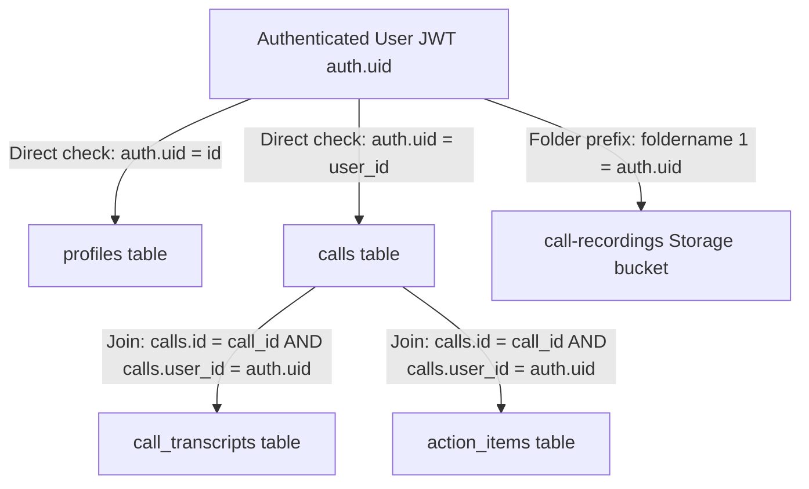

# Supabase Database Schema & Storage Migration Review

## 1. Migration Overview

* **File Location**: [supabase/migrations/20261018160800_initial_schema.sql](file:///Users/sayyadmazaharmehadi/aicallassistant/supabase/migrations/20261018160800_initial_schema.sql)
* **Target Database**: PostgreSQL 17+ (Supabase)
* **Security Posture**: 100% of user-accessible tables enforce PostgreSQL Row Level Security (RLS). Storage bucket `call-recordings` is strictly private (`public = FALSE`).
* **Clean Ownership Principle**: To eliminate data redundancy and prevent client-side identifier spoofing, child entities (`call_transcripts` and `action_items`) link strictly to `calls.id`. Ownership is verified exclusively by traversing to the parent call (`calls.user_id = auth.uid()`).

---

## 2. Table-by-Table Technical Specifications

### 2.1 `public.profiles`
Stores user profile information, assistant personalization, and data retention policies.

| Column | Type | Default / Constraint | Description |
| :--- | :--- | :--- | :--- |
| `id` | `UUID` | `PRIMARY KEY REFERENCES auth.users(id) ON DELETE CASCADE` | Mirrors the Supabase Auth user UUID. |
| `full_name` | `TEXT` | `NULL` | User's display name. |
| `phone_number` | `TEXT` | `NULL` | User's mobile phone number. |
| `assistant_name` | `TEXT` | `'AI Assistant'` | Personalized assistant name. |
| `assistant_greeting` | `TEXT` | Default introductory greeting | Scripted greeting spoken when answering. |
| `assistant_voice` | `TEXT` | `'Puck'` | Gemini Live voice persona (Puck, Aoede, Fenrir, Kore). |
| `assistant_persona` | `TEXT` | `'friendly_concise'` | Conversation style guidance. |
| `preferred_language`| `TEXT` | `'en-IN'` | Primary language/locale for conversation. |
| `recording_enabled` | `BOOLEAN` | `TRUE` | User preference toggle for audio recording. |
| `retention_days` | `INTEGER` | `30 CHECK (retention_days > 0 AND <= 365)` | Automated deletion retention window. |
| `created_at` | `TIMESTAMPTZ`| `now()` | Timestamp of profile creation. |
| `updated_at` | `TIMESTAMPTZ`| `now()` | Automatically updated via `handle_updated_at` trigger. |

#### Lifecycle Automation:
- **`on_auth_user_created` Trigger**: Listens for inserts on `auth.users` and automatically creates an initial profile row, preventing orphaned authenticated accounts.

---

### 2.2 `public.calls`
The master record for each simulated or carrier-forwarded call.

| Column | Type | Default / Constraint | Description |
| :--- | :--- | :--- | :--- |
| `id` | `UUID` | `PRIMARY KEY DEFAULT gen_random_uuid()` | Unique call session identifier. |
| `user_id` | `UUID` | `NOT NULL REFERENCES auth.users(id) ON DELETE CASCADE` | Owning user account. |
| `caller_name` | `TEXT` | `NULL` | Name of caller if detected or stated. |
| `caller_number` | `TEXT` | `'Unknown'` | Caller phone number or contact identifier. |
| `status` | `TEXT` | `'connecting' CHECK IN ('connecting', 'active', 'completed', 'failed', 'cancelled')` | Call state machine. |
| `call_type` | `TEXT` | `'simulated' CHECK IN ('simulated', 'cellular_forwarded')` | Distinguishes in-app simulations from carrier calls. |
| `caller_reason` | `TEXT` | `NULL` | Stated purpose of the call. |
| `summary` | `TEXT` | `NULL` | Concise 2-3 sentence AI post-call summary. |
| `urgency` | `TEXT` | `'low' CHECK IN ('low', 'medium', 'high', 'critical')` | Priority rating determined by AI analysis. |
| `urgency_explanation`| `TEXT` | `NULL` | Justification for the urgency rating. |
| `uncertainties` | `TEXT` | `NULL` | Unclear details or unverified caller statements. |
| `key_facts` | `JSONB` | `'[]'::jsonb` | Extracted facts (dates, times, numbers). |
| `is_important` | `BOOLEAN` | `FALSE` | User manual bookmark/flag. |
| `duration_seconds` | `INTEGER` | `0 CHECK (>= 0)` | Total active duration of call in seconds. |
| `recording_path` | `TEXT` | `NULL` | Supabase Storage object path (`{user_id}/{call_id}.wav`). |
| `recording_duration_seconds` | `INTEGER` | `CHECK (NULL OR >= 0)` | Duration of audio file. |
| `recording_size_bytes` | `BIGINT` | `CHECK (NULL OR >= 0)` | File size in bytes. |
| `created_at` | `TIMESTAMPTZ`| `now()` | Session creation time. |
| `started_at` | `TIMESTAMPTZ`| `NULL` | Timestamp when two-way audio began. |
| `ended_at` | `TIMESTAMPTZ`| `NULL` | Timestamp when session terminated. |

#### Indexes:
- `idx_calls_user_created_at (user_id, created_at DESC)`: High-performance reverse-chronological list queries.
- `idx_calls_user_important (user_id, is_important)`: Filter query for starred calls.
- `idx_calls_user_status (user_id, status)`: Fast active/pending session lookups.

---

### 2.3 `public.call_transcripts`
Turn-by-turn text dialog captured during the live call conversation.

| Column | Type | Default / Constraint | Description |
| :--- | :--- | :--- | :--- |
| `id` | `UUID` | `PRIMARY KEY DEFAULT gen_random_uuid()` | Unique transcript turn ID. |
| `call_id` | `UUID` | `NOT NULL REFERENCES public.calls(id) ON DELETE CASCADE` | Parent call reference. |
| `speaker` | `TEXT` | `NOT NULL CHECK IN ('caller', 'assistant')` | Identity of the speaker for this turn. |
| `text` | `TEXT` | `NOT NULL` | Spoken content for the turn. |
| `timestamp_ms` | `INTEGER` | `0 CHECK (>= 0)` | Milliseconds elapsed from call start. |
| `sequence_order` | `INTEGER` | `NOT NULL CHECK (>= 0)` | Strict sequential turn counter (0, 1, 2...). |
| `created_at` | `TIMESTAMPTZ`| `now()` | Record insertion timestamp. |

#### Constraints & Indexes:
- `uq_call_transcript_sequence UNIQUE (call_id, sequence_order)`: Prevents race conditions or duplicate sequence numbers.
- `idx_transcripts_call_sequence (call_id, sequence_order ASC)`: Instant ordered transcript reconstruction.

---

### 2.4 `public.action_items`
Actionable tasks extracted from the conversation.

| Column | Type | Default / Constraint | Description |
| :--- | :--- | :--- | :--- |
| `id` | `UUID` | `PRIMARY KEY DEFAULT gen_random_uuid()` | Unique task identifier. |
| `call_id` | `UUID` | `NOT NULL REFERENCES public.calls(id) ON DELETE CASCADE` | Parent call reference. |
| `task` | `TEXT` | `NOT NULL` | Description of the action required. |
| `due_date` | `TIMESTAMPTZ`| `NULL` | Optional extracted deadline or callback time. |
| `completed` | `BOOLEAN` | `FALSE` | Task completion checkbox status. |
| `completed_at` | `TIMESTAMPTZ`| `NULL` | Timestamp when user marked task completed. |
| `created_at` | `TIMESTAMPTZ`| `now()` | Record creation timestamp. |

#### Indexes:
- `idx_action_items_call_id (call_id)`: Lookups scoped to specific call.
- `idx_action_items_completed (call_id, completed)`: Fast pending task badge counts.

---

## 3. Row Level Security (RLS) Verification Matrix

All policies require `authenticated` role (`TO authenticated`). Anonymous users have zero read or write access.



| Table | Operation | Policy Rule (SQL) | Security Impact |
| :--- | :--- | :--- | :--- |
| `profiles` | `SELECT` | `auth.uid() = id` | Users can only view their own settings. |
| `profiles` | `INSERT/UPDATE` | `auth.uid() = id` | Users cannot modify another profile. |
| `calls` | `SELECT` | `auth.uid() = user_id` | Calls are strictly isolated per account. |
| `calls` | `INSERT/UPDATE` | `auth.uid() = user_id` | Client cannot spoof caller or owner. |
| `calls` | `DELETE` | `auth.uid() = user_id` | Cascades deletion to transcripts & tasks. |
| `call_transcripts` | `ALL` | `EXISTS (SELECT 1 FROM calls WHERE calls.id = call_transcripts.call_id AND calls.user_id = auth.uid())` | Access strictly granted through verified parent call ownership. |
| `action_items` | `ALL` | `EXISTS (SELECT 1 FROM calls WHERE calls.id = action_items.call_id AND calls.user_id = auth.uid())` | Access strictly granted through verified parent call ownership. |
| `storage.objects` | `ALL` | `bucket_id = 'call-recordings' AND (storage.foldername(name))[1] = auth.uid()::text` | Prevents unauthorized audio access or uploads. |

---

## 4. Private Storage & Signed-URL Protocol

1. **Bucket Properties**:
   - `id`: `'call-recordings'`
   - `public`: `FALSE` (Direct unauthenticated HTTP URLs return `403 Forbidden`).
   - `file_size_limit`: `52,428,800` bytes (50 MB max per audio file).
   - `allowed_mime_types`: `audio/wav`, `audio/x-wav`, `audio/mpeg`, `audio/mp4`.
2. **Folder Path Scheme**:
   - `{user_id}/{call_id}.wav`
   - Example: `a0eebc99-9c0b-4ef8-bb6d-6bb9bd380a11/c7a8b6e2-1234-4567-89ab-cdef01234567.wav`
3. **Signed Playback URL Workflow**:
   - The Android client requests: `GET /api/v1/calls/{call_id}/recording-url`
   - The backend checks call ownership, then invokes Supabase Storage Client:
     ```python
     signed_url = supabase.storage.from_("call-recordings").create_signed_url(
         path=f"{user_id}/{call_id}.wav",
         expires_in=900 # 15 minutes (900 seconds)
     )
     ```
   - The Android client streams playback using the short-lived HMAC token. The raw audio is never permanently accessible on public endpoints.
4. **Deletion**:
   - When a user deletes a call via `DELETE /api/v1/calls/{call_id}`, the backend removes the storage object `f"{user_id}/{call_id}.wav"` and deletes the call record.

---

## 5. SQL Verification Script (For Validation After Applying Migration)

Once approved to run on the project, the following test script verifies RLS isolation between two test users (`User A` and `User B`):

```sql
-- Transaction test block (automatically rolls back)
BEGIN;

-- 1. Create simulated auth users
INSERT INTO auth.users (id, email) VALUES
    ('11111111-1111-1111-1111-111111111111', 'userA@test.com'),
    ('22222222-2222-2222-2222-222222222222', 'userB@test.com')
ON CONFLICT DO NOTHING;

-- 2. Verify auto-creation of profiles
SELECT id, full_name, assistant_voice FROM public.profiles
WHERE id IN ('11111111-1111-1111-1111-111111111111', '22222222-2222-2222-2222-222222222222');

-- 3. Simulate User A inserting a call
SET LOCAL ROLE authenticated;
SET LOCAL "request.jwt.claims" = '{"sub": "11111111-1111-1111-1111-111111111111", "role": "authenticated"}';

INSERT INTO public.calls (id, user_id, caller_name, caller_number, summary)
VALUES ('aaaaaaaa-aaaa-aaaa-aaaa-aaaaaaaaaaaa', '11111111-1111-1111-1111-111111111111', 'Test Caller', '+1234567890', 'Delivery test');

INSERT INTO public.call_transcripts (call_id, speaker, text, sequence_order)
VALUES ('aaaaaaaa-aaaa-aaaa-aaaa-aaaaaaaaaaaa', 'assistant', 'Hello, how can I help?', 0);

-- 4. Verify User A can read their own call and transcripts
SELECT count(*) = 1 AS user_a_reads_own_call FROM public.calls;
SELECT count(*) = 1 AS user_a_reads_own_transcript FROM public.call_transcripts;

-- 5. Switch to User B context
SET LOCAL "request.jwt.claims" = '{"sub": "22222222-2222-2222-2222-222222222222", "role": "authenticated"}';

-- Verify User B CANNOT read User A's call or transcripts
SELECT count(*) = 0 AS user_b_blocked_from_calls FROM public.calls;
SELECT count(*) = 0 AS user_b_blocked_from_transcripts FROM public.call_transcripts;

-- Verify User B CANNOT insert a transcript into User A's call (should violate RLS WITH CHECK)
DO $$
BEGIN
    INSERT INTO public.call_transcripts (call_id, speaker, text, sequence_order)
    VALUES ('aaaaaaaa-aaaa-aaaa-aaaa-aaaaaaaaaaaa', 'caller', 'Malicious insert', 1);
    RAISE EXCEPTION 'RLS failed to block unauthorized transcript insert!';
EXCEPTION WHEN row_security_active_violation OR insufficient_privilege THEN
    RAISE NOTICE 'SUCCESS: RLS correctly blocked unauthorized transcript insert.';
END $$;

ROLLBACK;
```
