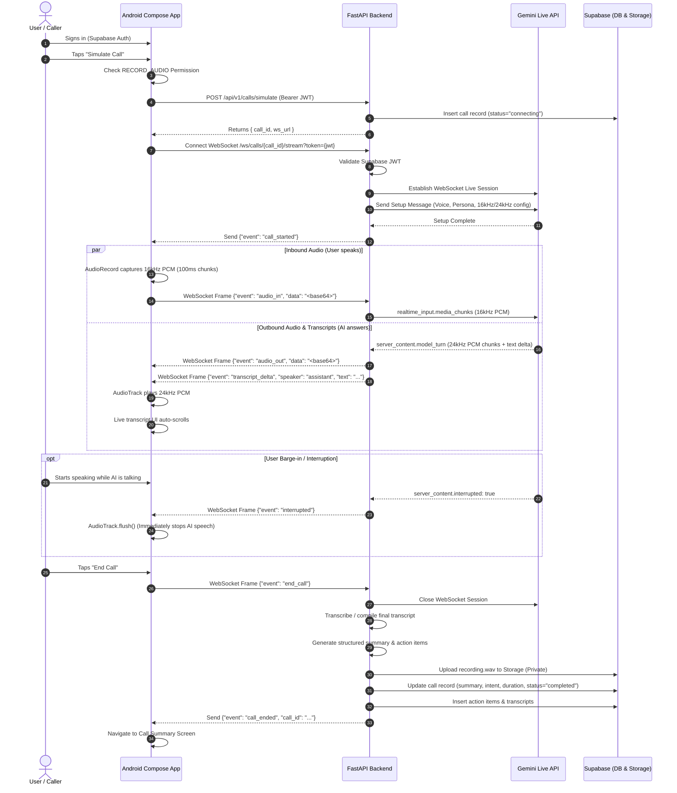

# Clean Architecture Specification: AI Call Assistant

## 1. System Overview & Clean Architecture Principles

The **AI Call Assistant** is an original, secure, privacy-first mobile and cloud application designed to provide conversational call answering, real-time live transcription, structured post-call summaries, and action item tracking.

### Core Architectural Mandates
1. **Separation of Concerns**: Clean separation between presentation (Android Jetpack Compose), real-time orchestration (FastAPI backend), voice intelligence (Gemini Live API), and persistence (Supabase).
2. **Backend-Centric Secrets**: The Gemini API key and Supabase `service_role` key never touch the Android client. The mobile app communicates using Supabase Auth JWTs.
3. **Simulation-First Architecture**: The initial phase implements a **Simulated Call Engine** using the Android device microphone and speaker over a local WebSocket bridge. This validates conversational latency, audio streaming, and UI responsiveness without telephony carrier dependencies.
4. **Clean-Room Design**: No proprietary code or reverse-engineered assets from Equal AI or other commercial assistants are used.

---

## 2. Target Architecture Diagram

```mermaid
graph TB
    subgraph Android_Client["Android Client (Kotlin + Jetpack Compose)"]
        UI[Compose UI / Screens]
        VM[ViewModels & StateFlow]
        MicEngine[AudioRecord Engine (PCM 16kHz Mono)]
        SpeakerEngine[AudioTrack Engine (PCM 24kHz Mono)]
        WSClient[OkHttp WebSocket Client]
        SupaClient[Supabase Kotlin SDK (Auth & Data)]
        
        UI --> VM
        VM --> MicEngine
        VM --> SpeakerEngine
        VM --> WSClient
        VM --> SupaClient
    end

    subgraph FastAPI_Backend["FastAPI Backend (Local Mac / Hosted Cloud)"]
        Router[HTTP & WebSocket Routers]
        AuthGuard[JWT Auth Verification Guard]
        CallManager[Call Session State Manager]
        AudioBridge[Bidirectional Audio Pipeline]
        GeminiClient[Google GenAI Live WebSocket Client]
        SupaAdmin[Supabase Admin Client (PostgreSQL & Storage)]
        
        Router --> AuthGuard
        AuthGuard --> CallManager
        CallManager --> AudioBridge
        AudioBridge <--> GeminiClient
        CallManager --> SupaAdmin
    end

    subgraph External_Services["Cloud Services"]
        GeminiLive["Gemini Live API (wss://generativelanguage.googleapis.com)"]
        SupaDB["Supabase PostgreSQL (RLS Protected)"]
        SupaAuth["Supabase Auth"]
        SupaStorage["Supabase Storage (Private Audio Bucket)"]
    end

    %% Network flows
    SupaClient -->|HTTPS / JWT Auth| SupaAuth
    SupaClient -->|HTTPS / PostgREST| SupaDB
    WSClient <-->|Secure Local Wi-Fi WebSocket| Router
    GeminiClient <-->|Secure Bidirectional WebSocket| GeminiLive
    SupaAdmin -->|Service Role Sync| SupaDB
    SupaAdmin -->|Upload Audio .wav| SupaStorage
```

---

## 3. Component Breakdown

### 3.1 Android Client Layer (`aicallassistant-android`)
* **Presentation**: 100% Jetpack Compose with Material 3 design system, single-activity architecture, and Jetpack Navigation Compose.
* **State Management**: MVVM architecture utilizing `ViewModel`, `StateFlow`, and immutable UI state data classes.
* **Audio Capture Engine**:
  - Uses `android.media.AudioRecord` with `AudioSource.VOICE_COMMUNICATION` (enabling hardware echo cancellation and noise suppression).
  - Captures raw linear PCM: **16,000 Hz, 16-bit signed integer, Little-Endian, Mono**.
  - Emits 100ms chunks (3,200 bytes per frame) directly to the WebSocket channel.
* **Audio Playback Engine**:
  - Uses `android.media.AudioTrack` configured for **24,000 Hz, 16-bit signed integer, Mono** (Gemini Live output format).
  - Maintains a jitter buffer of ~150ms to ensure smooth playback.
  - Supports **instant buffer flush** when the user interrupts the assistant.
* **Network & Persistence**:
  - `OkHttp 4.x` for durable WebSocket communication.
  - `supabase-kt` (Supabase Kotlin Client) for user authentication, profile preferences, and call history reading.

### 3.2 FastAPI Backend Layer (`aicallassistant-backend`)
* **Framework**: Python 3.13 + FastAPI with `uvicorn` asynchronous server.
* **Session Orchestration (`CallSessionManager`)**:
  - Handles concurrent call sessions in memory using thread-safe async queues.
  - Authenticates incoming WebSocket requests by validating the user's Supabase JWT.
* **Bidirectional Audio Bridge**:
  - Reads 16kHz PCM chunks from Android WebSocket and pushes directly to Gemini Live API.
  - Receives 24kHz PCM chunks from Gemini Live API and streams them back to Android.
  - Simultaneously accumulates audio frames in an in-memory WAV buffer for post-call storage.
* **Post-Call Processing Service**:
  - On call completion, saves the complete call record, turn-by-turn transcript, and structured summary to Supabase PostgreSQL.
  - Uploads the full audio recording to the private Supabase Storage bucket (`call-recordings/{user_id}/{call_id}.wav`).

### 3.3 Voice AI Layer (Gemini Live API)
* **Model**: `models/gemini-2.0-flash-exp` (or `gemini-2.0-flash-realtime-exp`).
* **Protocol**: Bidirectional WebSocket connection using the official `google-genai` Python SDK.
* **Audio Input**: `audio/pcm;rate=16000` (16kHz, 16-bit Little-Endian mono).
* **Audio Output**: `audio/pcm;rate=24000` (24kHz, 16-bit Little-Endian mono).
* **System Prompt / Persona**:
  ```text
  You are an intelligent, friendly AI call assistant screening a call on behalf of the user.
  Your goal is to politely answer the caller, find out who is calling and why, and summarize their message.
  Keep responses natural, concise (1-2 sentences), and conversational.
  ```

---

## 4. End-to-End Simulated Call Sequence



---

## 5. Network Connectivity for Local Development

* **Local Machine (Mac)**: Runs FastAPI backend bound to `0.0.0.0:8000`.
* **Android Emulator**: Connects to backend at `http://10.0.2.2:8000` and `ws://10.0.2.2:8000`.
* **Physical Android Device**: Connects to Mac over local Wi-Fi at `http://10.165.44.67:8000` and `ws://10.165.44.67:8000` (or via `adb reverse tcp:8000 tcp:8000` to allow `localhost:8000`).
* **Supabase & Gemini**: Connected securely over outbound HTTPS/WSS from the Mac.
