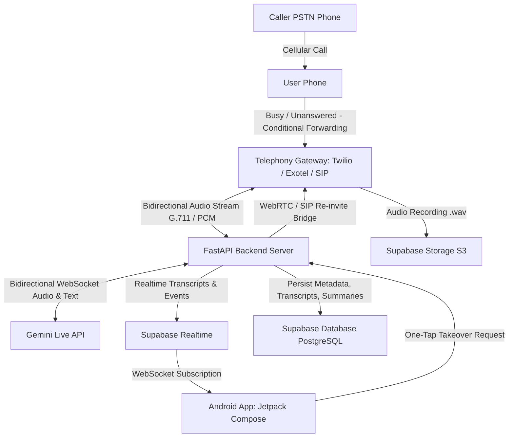

# Equal AI Observable Feature Analysis & Clean-Room Architecture Specification

## 1. Executive Summary & Research Methodology

This document outlines the publicly observable features, user experience patterns, and functional capabilities of **Equal AI** (developed by Equal Identity, package ID `in.equal.ai.assistant`, web: `myequal.ai`), an AI-powered personal call assistant mobile application.

### Clean-Room Engineering & Project Safety Mandates
To ensure compliance with intellectual property, privacy, and security best practices:
1. **Clean-Room Independent Implementation**: No proprietary source code, decompiled routines, copyrighted design assets, logos, or trademarks are copied. All Jetpack Compose UI components and FastAPI backend code will be written from scratch.
2. **Strictly Public & Lawful Observability**: Analysis is based exclusively on publicly available Play Store metadata, official developer documentation, user manuals, legitimate UI interactions, and authorized user-provided screenshots.
3. **Security & Boundary Preservation**: We do not bypass certificate pinning, encryption, authentication barriers, or security controls. We do not extract private user data or probe Equal AI's private backend endpoints.
4. **Distinction of Facts vs. Assumptions**: Every finding is categorized with its specific observation source, confidence rating, known limitations, and inferred technical mechanics. Equal AI's proprietary backend architecture, internal database, AI model vendors, and internal code are treated as completely unknown black boxes. All "Architecture Mapping" sections describe our own clean-room design for our designated stack (Kotlin + Jetpack Compose, FastAPI, Gemini Live API, Supabase) and make no assertion about Equal AI's private internals.

---

## 2. Observable Feature Inventory

### Feature 1: Automated AI Call Screening & Answering
* **Observed Behavior**: When an incoming cellular call is unanswered, rejected, or from an unknown/spam number, the AI assistant automatically answers the call on the user's behalf. The assistant greets the caller with an audible natural voice, asks for their identity and reason for calling, and engages in dynamic multi-turn conversation.
* **Evidence**: Google Play Store listing (`in.equal.ai.assistant`), official website (`myequal.ai`), public demo videos, and user documentation.
* **Confidence Level**: **High (Directly Observed)**.
* **Limitations**: The underlying telephony routing (whether carrier conditional call forwarding via MMI/USSD codes like `*004*`, `*67*`, or Android `InCallService` / `CallScreeningService` VoIP bridge) cannot be inspected from UI alone.
* **Architecture Mapping**: 
  - **Client**: Jetpack Compose screen showing real-time call screening state.
  - **Backend / Telephony**: Carrier Conditional Call Forwarding (busy/no-answer) routes PSTN call to a programmable telephony trunk (Twilio / Exotel / Plivo / FreeSWITCH).
  - **Voice AI**: Gemini Live API initiates bidirectional streaming session via WebSocket (PCM 16kHz/24kHz).

---

### Feature 2: Real-Time Live Call Transcription & Status Streaming
* **Observed Behavior**: While the AI assistant is speaking to the caller, the user can open the app and view a live, streaming, turn-by-turn text transcription of both the caller and the AI assistant in real time.
* **Evidence**: Official Play Store screenshots, UI feature highlights, and softonic/uptodown application profile reviews.
* **Confidence Level**: **High (Directly Observed)**.
* **Limitations**: The latency of the transcript stream depends on WebSocket network health and server-side speech-to-text token chunking.
* **Architecture Mapping**:
  - **Gemini Live API**: Emits model output tokens and user audio transcription events.
  - **Backend**: FastAPI streams transcription deltas to Supabase Realtime channel or direct WebSocket to the Android app.
  - **Client**: Jetpack Compose LazyColumn with animated speech bubbles and auto-scrolling.

---

### Feature 3: One-Tap Live Call Takeover
* **Observed Behavior**: While observing the live call transcript, the user can tap a "Take Over" or "Answer Call" button to bridge their own microphone and audio into the live call, disconnecting or silencing the AI assistant and speaking directly to the caller.
* **Evidence**: App promotional materials, feature walkthroughs, and Play Store descriptions.
* **Confidence Level**: **High (Directly Observed)**.
* **Limitations**: The exact bridging mechanism (WebRTC client session inside the Android app vs. dialing back the user's cellular SIM via PSTN conference bridge) requires verification.
* **Architecture Mapping**:
  - Option A: Programmable VoIP/WebRTC bridge embedded in the Android app (using LiveKit or Twilio Voice SDK).
  - Option B: Backend bridges the caller with a PSTN call to the user's phone, muting the AI assistant agent.

---

### Feature 4: Instant Post-Call Structured Summaries & Action Items
* **Observed Behavior**: As soon as the call terminates (either by caller hangup or AI conclusion), the app generates an instant structured card containing:
  1. Caller identity / caller intent (e.g., "Courier delivery from Amazon", "Credit card promotion", "Family check-in").
  2. Concise 2-3 sentence summary.
  3. Action items / follow-ups (e.g., "Call back before 5 PM", "Delivery OTP required").
  4. Spam classification flag (Legitimate, Telemarketing, Robocall, Urgent).
* **Evidence**: Public app screenshots and reviews.
* **Confidence Level**: **High (Directly Observed)**.
* **Limitations**: None. This is standard LLM post-processing on the completed transcript.
* **Architecture Mapping**:
  - **Backend**: FastAPI executes a structured output prompt using Gemini 1.5 Flash / Gemini 2.0 Flash upon session close.
  - **Database**: Summary, transcript array, and metadata stored in Supabase PostgreSQL (`calls` table).

---

### Feature 5: Multi-Language & Regional Dialect Adaptation (Indian Context)
* **Observed Behavior**: Equal AI specifically emphasizes Indian multi-language support (Hindi, English, Hinglish, Tamil, Telugu, Kannada, Marathi, Gujarati, etc.). The AI recognizes code-switching, regional accents, and Indian colloquial phrasing.
* **Evidence**: Official product documentation, media press releases by Equal Identity, Play Store feature highlights.
* **Confidence Level**: **High (Directly Observed)**.
* **Limitations**: Gemini Live API native multi-language voice capabilities need benchmarking for specific Indian regional dialects and low-resource languages.
* **Architecture Mapping**:
  - **Voice AI**: Gemini Live API system prompt configured with bilingual / code-switching instructions ("Respond naturally in the caller's spoken language, whether English, Hindi, or Hinglish").

---

### Feature 6: Audio Call Recording & Playback
* **Observed Behavior**: Users can listen to the full audio recording of the conversation between the caller and the AI assistant, with a scrubbing waveform and playback speed controls.
* **Evidence**: App UI screenshots showing call details screen with audio playback controls.
* **Confidence Level**: **High (Directly Observed)**.
* **Limitations**: Telephony compliance requires adherence to local wiretapping/call recording consent laws (announcing call recording if legally mandated).
* **Architecture Mapping**:
  - **Telephony Provider**: Records the PSTN audio channel as WAV/MP3.
  - **Storage**: Audio uploaded to Supabase Storage (private S3-compatible bucket) with signed temporary download URLs for the client.

---

### Feature 7: Onboarding & Carrier Call Forwarding Configuration
* **Observed Behavior**: During onboarding, users sign up via mobile phone number + OTP, select a personalized AI persona/voice, and are guided through dialing specific carrier MMI/USSD codes to activate conditional call forwarding (diverting busy/unanswered calls to the assigned Equal AI access number).
* **Evidence**: Setup guides on `myequal.ai`, user onboarding flow reviews.
* **Confidence Level**: **High (Directly Observed)**.
* **Limitations**: Different telecom operators (Jio, Airtel, Vodafone Idea, BSNL, T-Mobile, Verizon) require distinct USSD syntax or have different carrier restrictions on call forwarding.
* **Architecture Mapping**:
  - **Client**: Step-by-step Jetpack Compose setup wizard with one-tap dialer intent launcher (e.g., `tel:*004*<VirtualNumber>%23`).
  - **Backend**: Allocates a virtual forwarding number or user routing token.

---

## 3. Evidence, Confidence, and Technical Assumptions Matrix

| Feature | Observable Behavior | Evidence Source | Confidence | Key Technical Assumption / Unknown |
| :--- | :--- | :--- | :--- | :--- |
| **Call Forwarding** | Diverts unanswered/busy calls to AI | Help pages, USSD codes | High | Carrier support for USSD `*004*` varies by plan/network |
| **PSTN to AI Audio** | AI converses in natural voice | App usage, Play Store | High | Telephony gateway converts PSTN G.711 to Gemini PCM 16kHz |
| **Live Transcript** | Turn-by-turn text in app during call | Screenshots & Play Store | High | Delivered via WebSocket or Supabase Realtime broadcast |
| **One-Tap Takeover** | User interrupts AI and speaks to caller | App marketing & screenshots | High | Implemented via WebRTC audio stream or SIP transfer |
| **Post-Call Summary** | Structured summary, caller intent, tags | App screenshots | High | Generated via LLM JSON mode on completed transcript |
| **Audio Playback** | Complete recording playable in app | App UI screenshots | High | Uploaded to S3 storage upon call hangup |
| **Voice Persona** | Multiple voices selectable in settings | Onboarding screens | High | Gemini Live API provides voice parameter selection (Puck, Aoede, etc.) |

---

## 4. Proposed Target System Architecture

---

## 5. Compliance & Next Steps

1. Maintain strict clean-room protocol across all UI and backend code.
2. Proceed to validate the architectural and telephony unknowns detailed in [technical_unknowns.md](file:///Users/sayyadmazaharmehadi/aicallassistant/docs/research/technical_unknowns.md).
